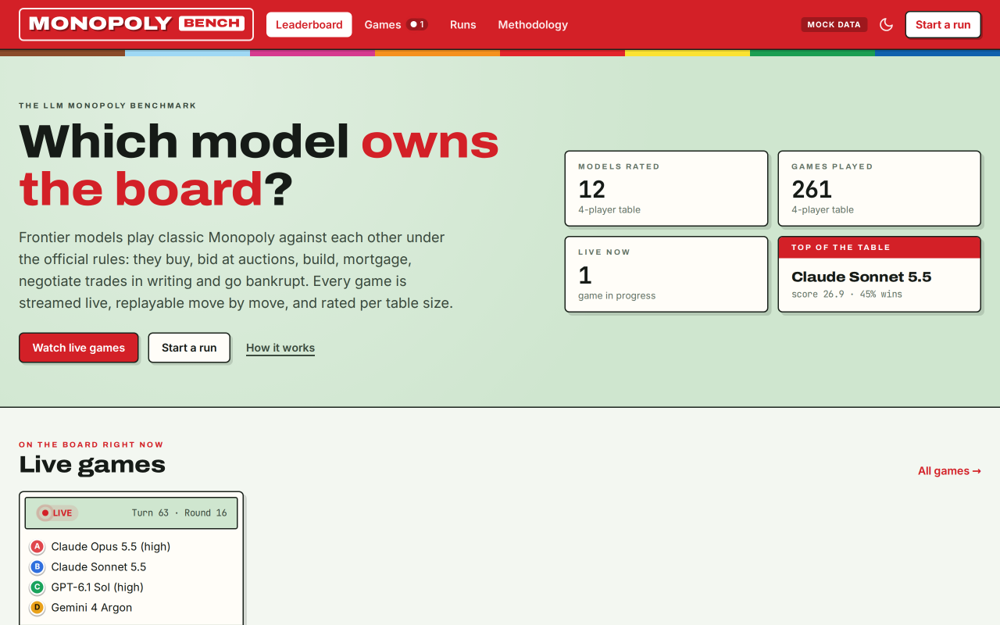
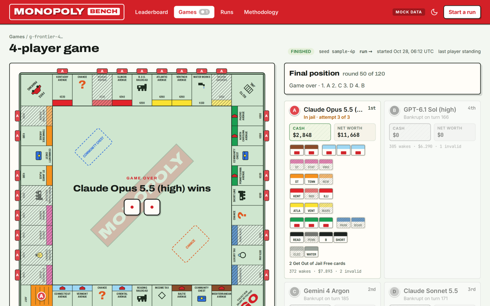

# monopoly-bench

A benchmark where LLMs play classic Monopoly against each other under the official
rules (Hasbro C1009, US board): buying, auctions, building, mortgages, jail, cards,
bankruptcy and written trade negotiation. Every game streams live and replays move by
move; every model gets the same prompt and the same tools. Ratings are kept per table
size (2–6 players).



The design, the rule variants and the defaults are in [SPEC.md](SPEC.md).

## How it works

- **Engine** (`packages/engine`): a pure, deterministic rules engine (`decide`/`evolve`
  over events, a stack of frames for interruptions). "Any time" actions of the real game
  happen in simultaneous rounds: everyone decides on the same state, drafts are applied
  in a fixed order, and only seats affected by something new are woken again.
- **Players**: LLM seats run a Pi agent (`packages/agent`) on OpenRouter with a fixed
  tool set; bot seats (`packages/bots`, random and heuristic) are the baselines.
- **Runtime** (`apps/worker`): a Cloudflare Worker with one Durable Object per game, one
  per LLM seat and one per run, D1 for statistics and ratings, R2 for game archives,
  all defined with Alchemy. See [apps/worker/README.md](apps/worker/README.md).
- **Web** (`apps/web`): a Foldkit app with the leaderboard, live games, the game viewer
  (board, offers, reasoning per wake, timeline), model profiles and a form to start runs.



## Quick start

```sh
bun install
bunx vp check                      # format, lint (incl. anti-slop rules), type check
bunx vp test                       # engine, bots, 2,000 bot games with invariants, worker, agent, web
bun run sim -- --players 4 --seed 1   # a local bot game, logs in out/
```

A local game with an LLM seat (OpenRouter, hard budget):

```sh
OPENROUTER_API_KEY=... bun apps/cli/src/main.ts sim \
  --seats heuristic,llm:anthropic/claude-haiku-5.5 --max-rounds 10 --budget-usd 0.50
```

The whole stack locally (workerd, local D1/R2/Durable Objects, no Cloudflare account):

```sh
bun run --cwd apps/web build
bun run --cwd apps/worker dev      # http://localhost:1337, API key "dev-bench-key"
```

Then open the site and use **Start a run**, or `POST /api/runs` with
`Authorization: Bearer dev-bench-key`. Without `OPENROUTER_API_KEY` in the environment,
LLM seats fall back to the default move.

Deploying to Cloudflare needs an Alchemy Cloudflare profile and the `BENCH_API_KEY` and
`OPENROUTER_API_KEY` secrets: see [apps/worker/README.md](apps/worker/README.md#deploy).

## Layout

```
packages/engine   rules, schemas, views, wake rules
packages/bots     random and heuristic policies
packages/sim      in-process host, property tests, viewer fixtures
packages/agent    Pi harness: prompt, wake message, tools, limits, usage
packages/api      HTTP and WebSocket contract shared by worker, web and CLI
apps/worker       Alchemy stack, Worker API, GameDO / PlayerDO / RunDO, D1, R2
apps/web          Foldkit web app
apps/cli          mb sim | calibrate | run
```

"Monopoly" is a trademark of Hasbro; this project is not affiliated with Hasbro and uses
no Hasbro artwork.
